# Speers Foods — Web Platform | Plataforma Web

**Case study / Estudo de caso** · React · TypeScript · Vite · CSS · Supabase

> **PT:** Este repositório apresenta a interface, a arquitetura e as funcionalidades do projeto. O código-fonte e as configurações de produção não são públicos. As imagens documentam uma versão do projeto; funcionalidades e dados podem variar na implantação atual.
>
> **EN:** This repository documents the interface, architecture, and features of the project. Source code and production configuration are not public. Screenshots reflect a project version; features and data may differ in the current deployment.

[🇧🇷 Português](#-português) · [🇺🇸 English](#-english)

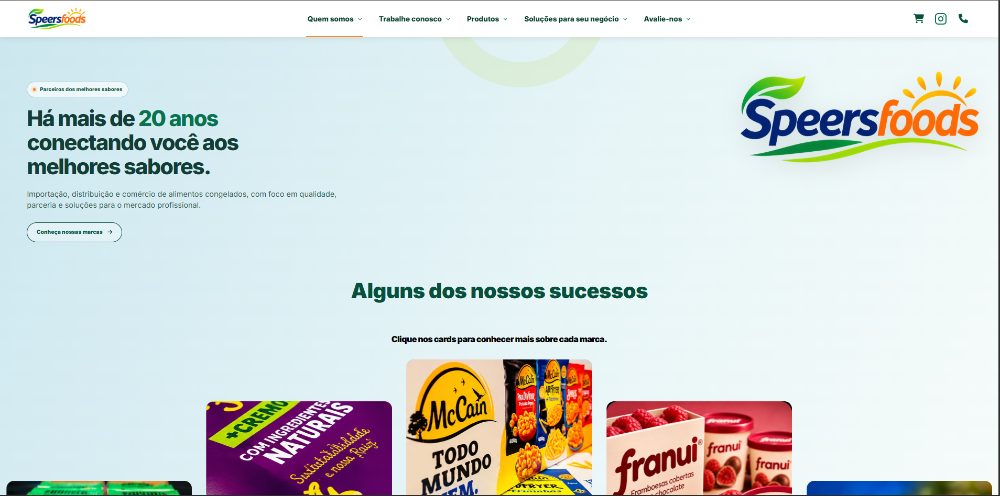

---

## 🇧🇷 Português

### Visão geral

A **Speers Foods** atua na distribuição de alimentos congelados e perecíveis. Este projeto apresenta uma plataforma web voltada à comunicação institucional, à descoberta de produtos e ao relacionamento com clientes profissionais.

O objetivo do desenvolvimento foi reunir identidade visual, catálogo navegável e canais de contato em uma experiência digital coerente, com uma área administrativa para acompanhamento de indicadores do site.

### Principais funcionalidades

| Área | Implementação apresentada |
| --- | --- |
| Interface institucional | Página inicial, história da empresa, marcas parceiras e conteúdo institucional |
| Catálogo digital | Listagem de produtos, pesquisa, filtros por marca, ordenação e paginação |
| Carrinho de orçamento | Seleção de produtos, alteração de quantidades e formulário de solicitação |
| Atendimento comercial | Formulário orientado ao perfil, à região e à necessidade do cliente |
| Avaliações | Interface para avaliação da facilidade de uso e confiança na experiência |
| Painel administrativo | Indicadores de visitas, sessões, interações de orçamento e avaliações |

### Interface e experiência

**Identidade visual e marcas** — uso de uma linguagem visual consistente com as cores da empresa, cards interativos e navegação por seções.

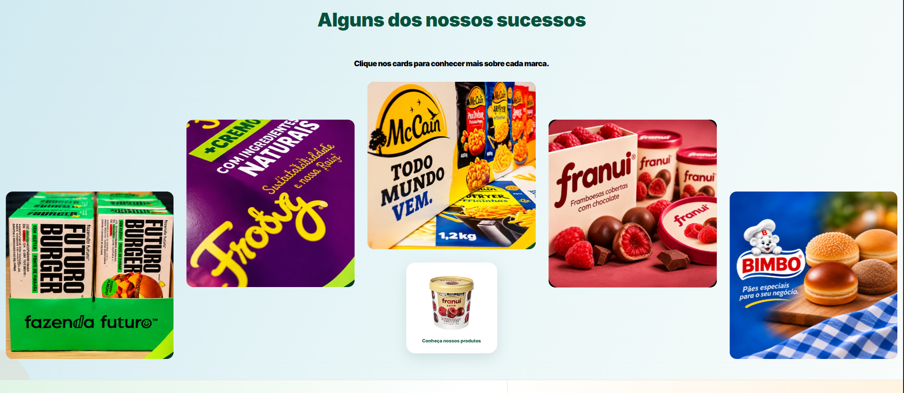

**Cards de marcas — verso interativo:** ao clicar em um card, a interface revela informações sobre a marca e permite retornar à imagem inicial.

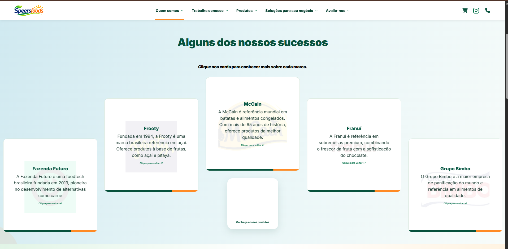

**Catálogo e busca** — navegação por produtos com recursos de filtragem e ordenação.

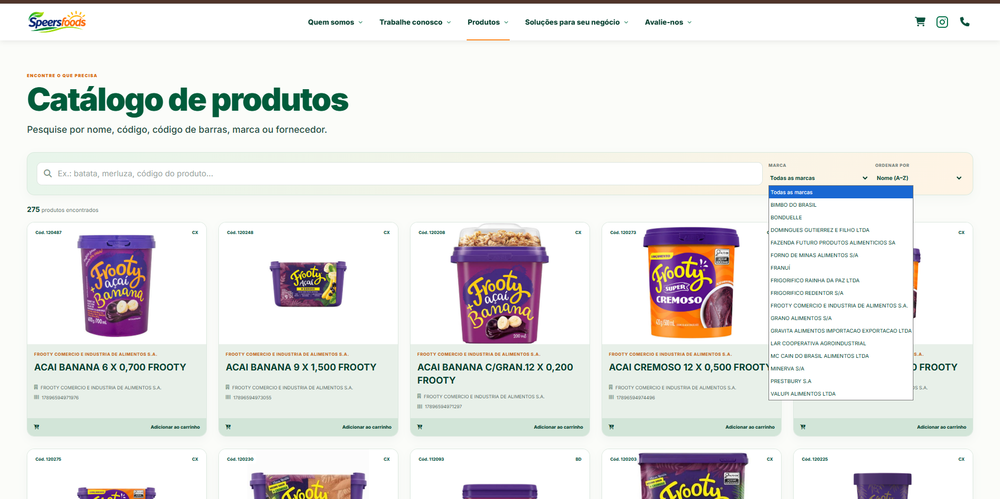

**Carrinho de orçamento** — interface para organizar uma solicitação comercial antes do envio.

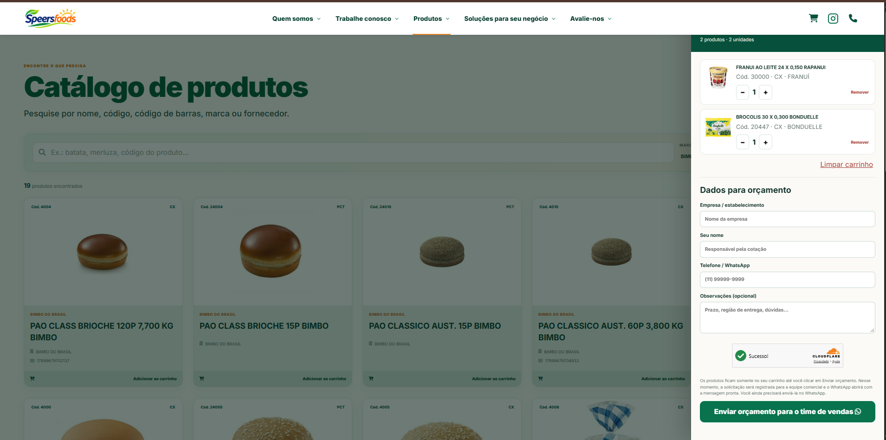

**Atendimento** — formulário para entender o tipo de estabelecimento e a necessidade do cliente.

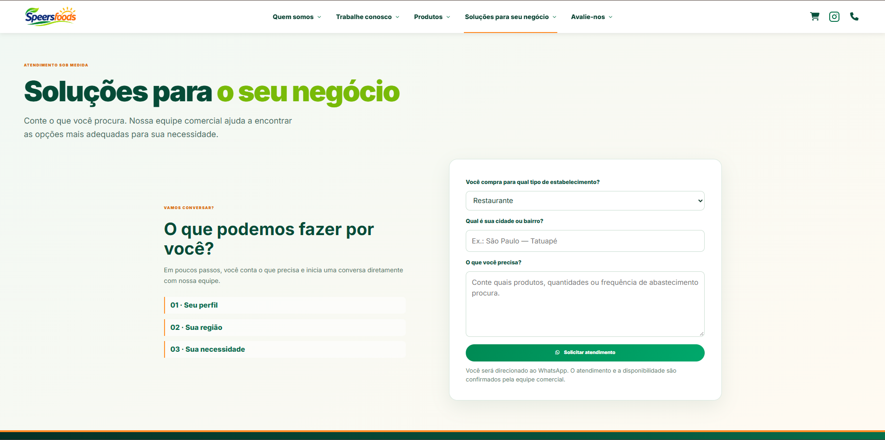

**Avaliações** — coleta de feedback sobre a experiência no site.

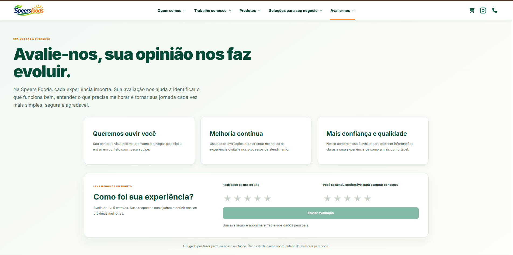

**Painel administrativo** — visualização de métricas agregadas e de satisfação. Os valores numéricos foram ocultados na captura pública.

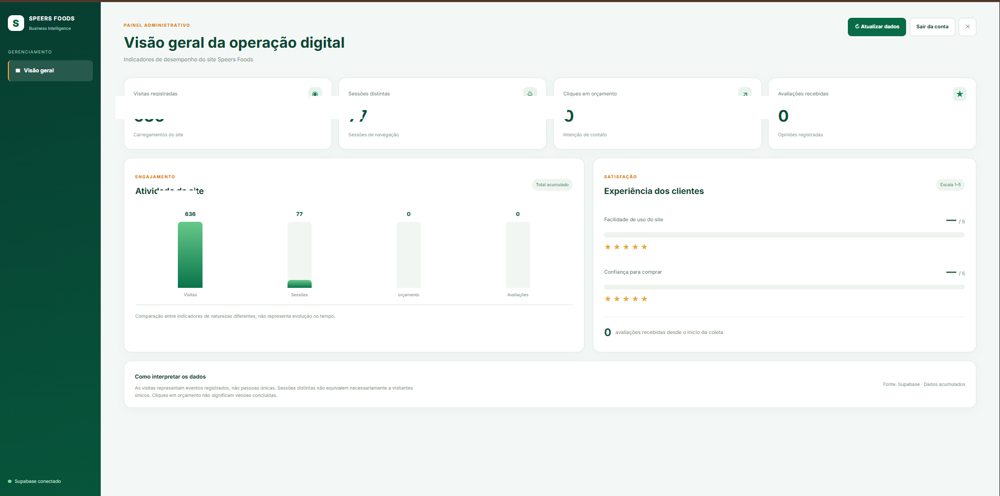

### Arquitetura e tecnologias

- **React e TypeScript:** construção da interface em componentes tipados.
- **Vite:** ambiente de desenvolvimento e compilação do front-end.
- **CSS modular:** estilos organizados por áreas e funcionalidades da interface.
- **Hooks e componentes reutilizáveis:** separação de responsabilidades entre catálogo, cards, carrinho e dashboard.
- **Supabase:** integração utilizada no projeto para funcionalidades de dados e autenticação administrativa; a configuração e as credenciais não são divulgadas.

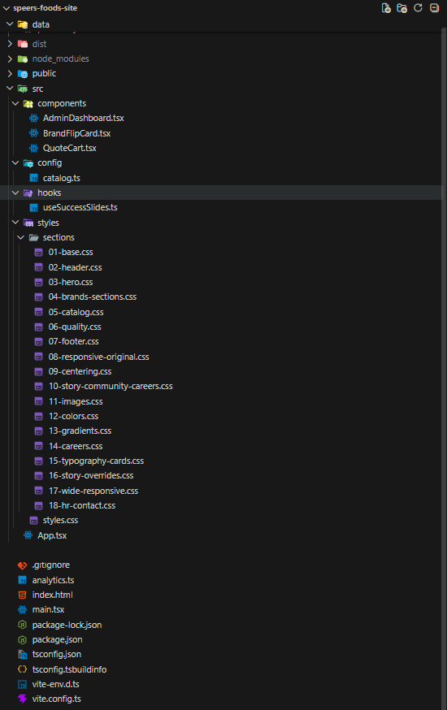

### Outras páginas

| Institucional | Carreiras | Marcas parceiras |
| --- | --- | --- |
| 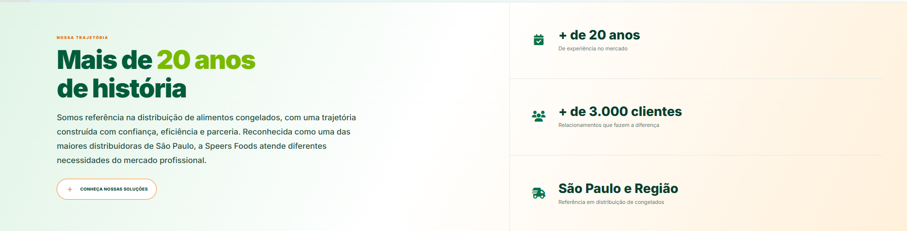 | 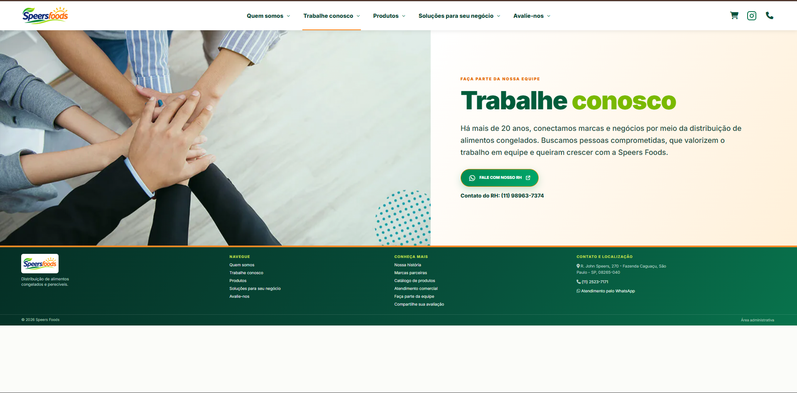 | 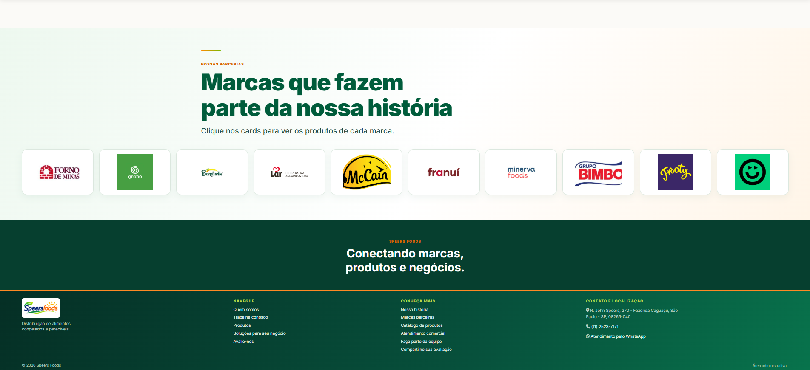 |

### Escopo e privacidade

Este é um **portfólio de desenvolvimento**, não uma distribuição do software. O repositório não inclui código-fonte, chaves, arquivos `.env`, dados de clientes ou acesso ao banco de produção. As capturas são apresentadas para fins de documentação e demonstração do trabalho.

---

## 🇺🇸 English

### Overview

**Speers Foods** operates in frozen and perishable food distribution. This project showcases a web platform designed for corporate communication, product discovery, and engagement with professional customers.

The development goal was to bring brand identity, a searchable product catalog, and contact channels together in a cohesive digital experience, complemented by an administrative area for website performance insights.

### Key features

| Area | Features showcased |
| --- | --- |
| Corporate website | Homepage, company background, partner brands, and institutional content |
| Digital catalog | Product listings, search, brand filters, sorting, and pagination |
| Quote cart | Product selection, quantity adjustments, and quotation request form |
| Business inquiries | Guided form for business type, location, and customer needs |
| Customer feedback | Rating interface for usability and shopping confidence |
| Admin dashboard | Visits, sessions, quote interactions, and feedback indicators |

### Product experience

**Brand experience** — a visual system based on the company identity, interactive brand cards, and section-based navigation.

**Interactive brand cards — flipped view:** selecting a card reveals information about the brand, with an option to flip back to the image.

**Searchable catalog** — product discovery with filtering and sorting tools.

**Quote cart** — a guided interface to organize a commercial inquiry.

**Business contact** — a structured form to capture the customer's business type and needs.

**Feedback** — a rating interface focused on user experience.

**Administrative dashboard** — aggregated engagement and satisfaction metrics. Numerical values are hidden in this public screenshot.

### Technology and architecture

- **React + TypeScript:** component-based, typed user interface.
- **Vite:** front-end development and build tooling.
- **Modular CSS:** styles organized by page area and feature.
- **Reusable components and hooks:** separation of catalog, brand cards, cart, and dashboard logic.
- **Supabase:** used in the project for data-related functionality and admin authentication; production settings and credentials are not shared.

### Additional pages

| About | Careers | Partner brands |
| --- | --- | --- |
|  |  |  |

### Scope and privacy

This repository is a **development case study**, not an open-source release. It contains no application source code, secret keys, `.env` files, customer records, or production database access. Screenshots are included solely to document the project and its interface.
